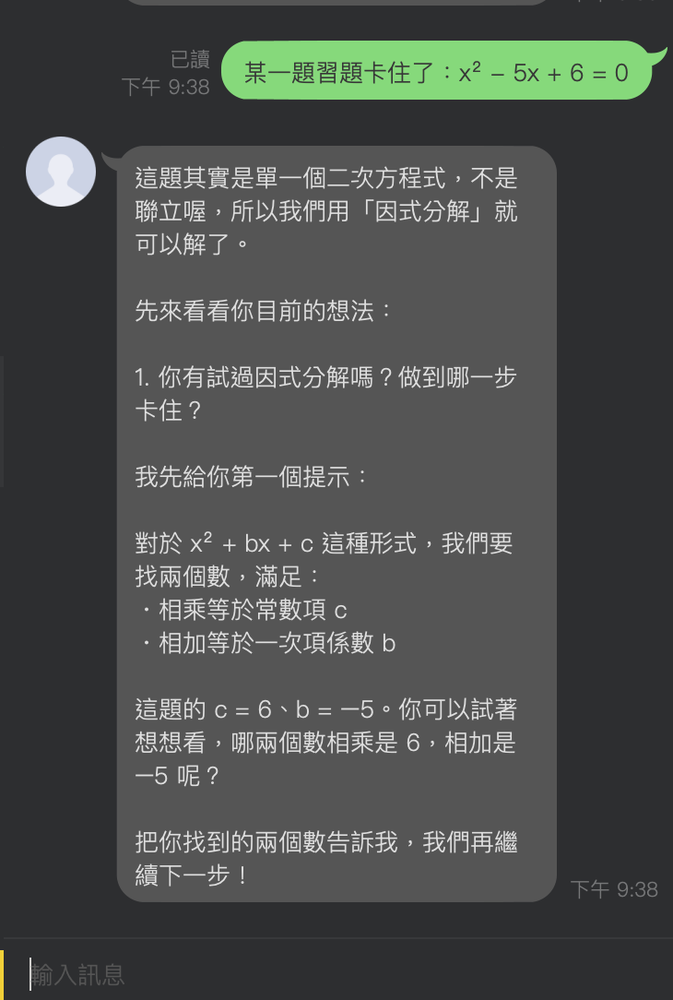
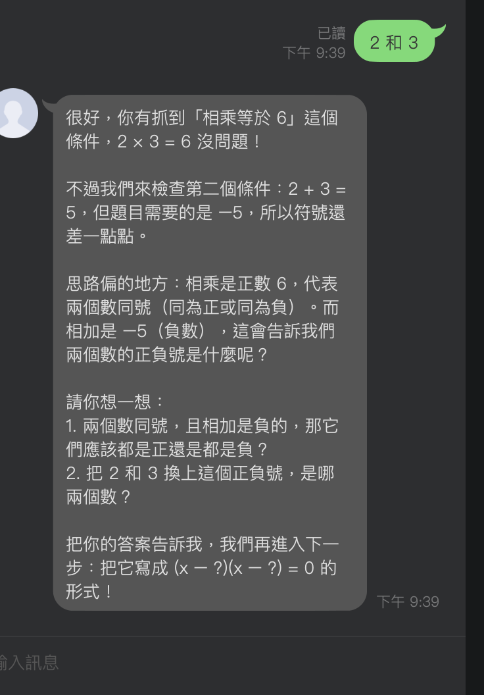
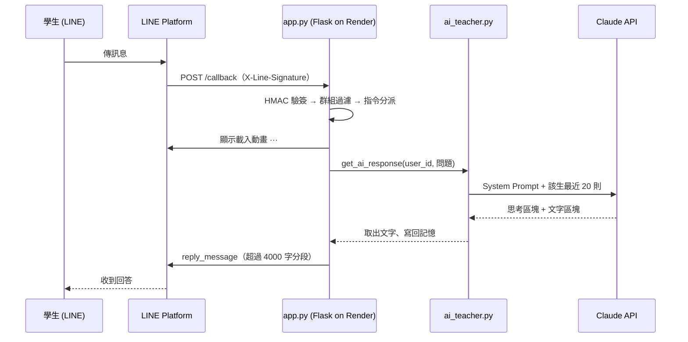

# AI 教學助理 — LINE × Claude 引導式教學 Bot

> 不直接給答案，而是像家教一樣一步步引導高中生自己想出來的 LINE Bot。


LINE ID：`@574gwhfk`｜部署：Render（Singapore）

---

## Demo

| ① 學生卡題 → 先問想法、給第一個提示 | ② 學生答錯 → 指出哪裡偏了，不給答案 |
|:---:|:---:|
|  |  |

學生回答「2 和 3」（正負號錯誤），Bot 先肯定「相乘 = 6 沒問題」，再引導「相乘為正 → 同號；相加為負 → 都是負的」，讓學生自己修正。

另一段對話紀錄（Claude Sonnet 5.5，每輪約 3 秒）：

```
學生：二次函數 y = x² - 4x + 1 的頂點是多少？
助理：這題很適合用「配方法」來找頂點，我們一起來試試看！
      第一個提示：看 x² - 4x 這兩項，如果要湊成 (x - ?)² 的樣子，你覺得「?」應該是多少？

學生：a=1, b=-4
助理：你正確找出了係數，這是很好的第一步！不過我剛剛問的是括號裡的「?」……
      x 的係數是 -2m，對應 -4，你可以解出 m 是多少嗎？

學生：所以 x = 2？
助理：答對了，m = 2！不過要小心：m 是括號裡的數字，不是 x 的值……
```

Bot 會**追問、給提示、糾正觀念錯誤**；學生試兩次仍卡住才示範完整步驟，並出類似題讓學生練習。

---

## 功能

| 功能 | 說明 |
|------|------|
| 引導式教學 | 四段式 System Prompt（角色／範疇／風格／引導原則），不直接給答案 |
| 多輪記憶 | 每位學生依 `user_id` 隔離，保留最近 10 輪 |
| 班級群組 | 只回應 `@AI 教學助理` 或「問：」開頭，不洗版 |
| 指令 | `清除` 重置自己的記憶、`幫助` 顯示說明 |
| 體驗 | 回覆前顯示「···」載入動畫；長回覆自動分段 |
| 範疇控管 | 只回答高中學科；感情、政治等話題婉拒並轉介師長 |

---

## 架構



| 檔案 | 職責 |
|------|------|
| `app.py` | LINE 平台層：驗簽、群組過濾、指令、載入動畫、分段回覆 |
| `ai_teacher.py` | AI 邏輯層：人設、對話記憶、Claude 呼叫與錯誤處理 |

**分層的好處**：換成客服 Bot、圖書館 Bot 只需替換 `ai_teacher.py`，平台層不動。

---

## 技術亮點：講義沒寫、實作時發現並修正的問題

本專案起點是一份教學講義，以下是照做時發現的問題與我的解法：

### 1. 群組 @Bot 永遠不會觸發
講義用字串比對 `"@AI教學助理" in text`，但 Bot 實際顯示名稱是「AI 教學助理」（**有空格**）。
→ 改用 LINE mention 資料的 `is_self` 欄位，直接判斷「是不是 @ 我」，Bot 改名也不受影響。

### 2. 對話歷史截斷後 Claude API 回 400
講義先 append 再取 `list[-20:]`，第 21 則時歷史會以 `assistant` 開頭，違反 API 規定。
→ 改用 `deque(maxlen=20)`，送出前確保第一則是 `user`；Claude 失敗時把提問移出歷史，避免連續兩則 `user`。

### 3. 新模型回傳思考區塊，`content[0].text` 直接崩潰
Sonnet 5.5 預設開啟 adaptive thinking，`content[0]` 是 `ThinkingBlock`。這行又在 `try` 外，**上線後每則提問都會讓 Bot 完全沒反應**。
→ 只取 `type == "text"` 區塊、空回覆視為失敗；並依官方建議設定聊天用 `effort: low`、開啟 server-side fallback。
→ **教訓**：原本 mock 只回文字區塊，測試全綠、上線全掛。現在 mock 照真實回傳形狀寫，並加了「只有思考區塊」的測試。

### 4. 錯誤細節外洩
講義把 `str(e)` 直接回給學生。→ 學生只看到道歉訊息，細節寫進 log。

### 5. macOS 本機開發踩雷
- `ngrok http 5000` 回 403：5000 port 被 AirPlay 接收器佔用 → 本地改 5001
- 外接 SSD（exFAT）不支援 symlink，venv 必須 `--copies`；macOS 產生的 `._*` 影子檔要排除在 git 外

---

## 金鑰防漏：三道防線

| 防線 | 機制 | 擋什麼 |
|------|------|--------|
| 1 | `.gitignore` | `.env`、`.env.*`、`*.pem`、`*.key` |
| 2 | `pre-commit` hook | `git add -f .env`；任何檔案內容含 `.env` 的**真實值**；gitleaks 規則（內建 + 自訂 LINE 規則） |
| 3 | `pre-push` hook | 掃描本次要推的所有 commit，連 `commit --no-verify` 繞過的也擋 |

**為什麼比對真實值而不只靠 regex**：LINE Channel secret 是 32 碼 hex，regex 不是漏抓就是誤判；直接拿本機 `.env` 的值去比對，金鑰換了變數名稱、貼進 Markdown 都抓得到。

用假金鑰的測試 repo 驗證過 6 種外洩情境，全部攔截。

---

## 本機執行

```bash
git clone https://github.com/kolyfish/line-edu-bot.git && cd line-edu-bot
python3 -m venv venv && source venv/bin/activate
pip install -r requirements.txt -r requirements-dev.txt
cp .env.example .env              # 填入 LINE 與 Anthropic 金鑰
git config core.hooksPath .githooks && brew install gitleaks   # 啟用金鑰防漏
pytest -q                          # 18 個測試
python app.py                      # http://localhost:5001
```

本地接 LINE：`ngrok http 5001`，把 `https://xxx.ngrok-free.app/callback` 填到 LINE Developers 的 Webhook URL。

### 部署到 Render
- Build：`pip install -r requirements.txt`
- Start：`gunicorn -w 1 app:app`（對話記憶在記憶體，必須單一 worker）
- Environment：`LINE_CHANNEL_ACCESS_TOKEN`、`LINE_CHANNEL_SECRET`、`ANTHROPIC_API_KEY`

---

## 測試

```bash
pytest -q
```

用真實 HMAC 簽章模擬 LINE webhook，mock 掉 Claude 與 LINE API，涵蓋：個人提問、學生記憶隔離、幫助/清除指令、群組觸發規則（5 種）、長訊息分段、錯誤簽章、歷史截斷、Claude 失敗、只有思考區塊、呼叫參數。

---

## 已知限制與下一步

| 限制 | 改進方向 |
|------|----------|
| 對話記憶在記憶體，重啟就清空、只能單 worker | 改用 Redis（`LPUSH` + `LTRIM`） |
| Render Free 閒置休眠，第一則訊息較慢 | 已加載入動畫；正式使用升級付費方案 |
| 只支援文字 | 加圖片訊息處理，讓學生拍作業題目直接問 |
| 老師看不到學習狀況 | 記錄提問科目，做班級學習分析儀表板 |

---

## 文件

- [使用手冊（學生／老師）](docs/01_使用手冊.md)
- [專案教學：從零到上線](docs/02_專案教學.md)
- [類似專案參考指南](docs/03_類似專案參考指南.md)
- [開發者設計日誌](DEV_JOURNAL.md)
